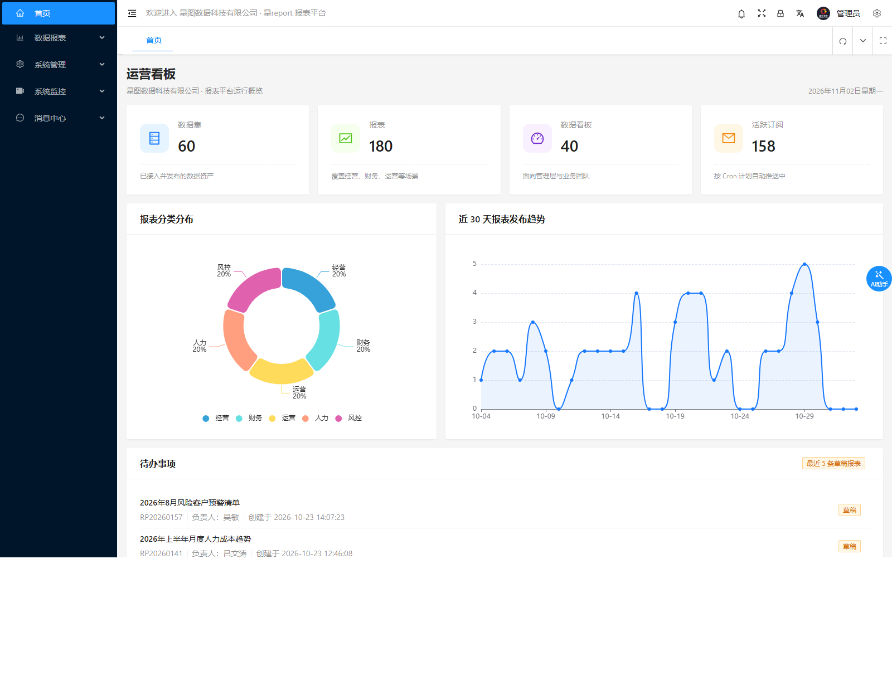

# 若依历史系统复刻靶场

把 32 座「客户系统」按当年上线时的原始状态重建，每套换成一家虚构单位、灌入成型业务数据，
让它看起来就是一台正在干活的生产系统。

**用途**：给安全扫描器做验证与能力测量的标尺。

- 录音/演示时，被测工具打的是「像真的一样」的站点，不是裸奔的默认页。
- 做版本差异研究：同一套工具在 R1–R10 上必须给出**不同**的判定结果。
- 做误报检验：C3 是假漏洞蜜罐，R5/R10/R11 是负样本，用来测工具会不会「看错」。

> **设计原则：靶场是标尺，标尺不能迁就被测物。**
> 所以这里坚持三件事：
> 1. 底座用官方 tag 源码，二开只做加法，接口契约一个字符不改。
> 2. 不复刻扫描器「想象中的特征」——只复刻真实产品的真实行为。
> 3. 发现工具测不出，就去查工具，不动靶场。

## 实拍展示

下面每张都是靶场真实起来之后**程序化截图**，不是设计稿。四个站点分别代表四个测量维度，
刻意选成这样——只看界面差异最大、最容易混淆的几座。重拍方式见
[`scripts/shots.py`](scripts/shots.py)（Playwright + Chromium），一次命令全部重来。

### R1 · 版本曲线起点（若依 4.5.1 单机版）


藤县人民医院门诊挂号系统。**保留了官方原版 favicon 和登录页布局**，作为整条版本曲线的基线对照组——
后面 R2–R5 的差异必须相对它有可见变化，否则说明二开走样了。

### R10 · 变体识别（JeecgBoot 3.6.3）



星图报表。这是**整个靶场里和若依家族长得最不像的一座**：Ant Design Vue 品牌化后台、
PBEWithMD5AndDES 口令、完全不同的 API 前缀 `/jeecg-boot/`。
用它测「能不能认出这其实是个 Java 后台框架，而不是当成陌生的定制系统」。

### D1 · 二开变形（若依 4.6.2 换皮）


登录路径改成了 `/portal/auth/signin`，context-path 是 `/portal`，标题、favicon、
错误页全部替换。**官方特征一个不留**：没有 `/login`、没有 `/captcha/captchaImage`、
没有若依的版本号。用它测「离开官方指纹之后，识别能力和登录链适配还在不在」。

### C3 · 假漏洞蜜罐

诱饵页面的共同点：**返回 200，内容是编造的**。看着像洞，其实什么都没有。

| 假 `.git/config` | 假 Druid 监控台 |
|---|---|
|  |  |

扫描器如果只看状态码和关键字，这三座页面会全线判成 CONFIRMED。
C3 存在的唯一目的就是抓这种误报。

> 完整截图清单与拍摄参数：[docs/shots/INDEX.md](docs/shots/INDEX.md)

## 32 座靶场一览

| 组 | 数量 | 内容 |
|---|---|---|
| **R1–R12** | 12 | 若依官方形态：单机 4.5.1→4.8.3、Vue、Cloud、Plus、JeecgBoot、非若依负样本 |
| **R13** | 1 | 留出集（hold-out），只在阶段验证时启用，不参与日常回归 |
| **C1** | 4 | 运维组件：Jolokia / H2 Console / Spring Data REST / Spring Cloud Config |
| **C2** | 4 进程 / 3 产品 | Spring 漏洞：Spring Boot Admin（server + client）/ Spring4Shell / Cloud Function |
| **C4** | 6 | 中间件：Redis / MinIO-S3 / RocketMQ 未授权 + 三类 SSTI（真实模板引擎求值） |
| **C3 / D1 / A2 / C5** | 4 | 蜜罐假漏洞 / 若依二开变形 / TOTP 双因子 / 暴露但需认证 |
| **Y1** | 1 | 芋道 yudao（非若依，v1.6 新增），独立脚本管理，不在 `lab.py` 注册表里 |

`lab.py status` 显示的总数是 **34**——因为其中 3 个是基础设施（`infra:mysql` / `infra:redis` /
`infra:nginx`），减掉之后是 31 座站点靶场，加 Y1 共 32 座。

完整清单与端口：[docs/靶场总览.md](docs/靶场总览.md)

## 快速开始

### 前置条件

| 组件 | 版本 | 说明 |
|---|---|---|
| JDK 8 / 17 | 8u44 / 17.0.x | 单机版与 Y1 用 8 跑；Spring Boot 3 系列与 Y1 构建用 17 |
| Maven | 3.9.x | 构建各站 jar |
| MySQL | 8.0 | 数据实例跑在 **13307**（不是 3306） |
| Redis | 5.x | 6379 有密码 `ruoyi123`；**16379 无密码**（Y1 与 C4-1 用这个） |
| Nginx | 1.26 | 191xx / 193xx 入口，反代到 192xx 后端 |
| Python | 3.12 | 跑 `scripts/*.py`，需 requests；截图另需 playwright + Pillow |

> 项目**不自带**这些二进制，需自行安装。`scripts/00_probe.bat` 可探测本机已装了什么。

### 配置本机路径

各脚本需要知道 JDK / Maven / Python 装在哪。两种方式，**环境变量优先**：

**方式一：环境变量**（推荐给 CI 或临时覆盖）

```bat
set LAB_JDK8=D:\java\jdk8
set LAB_JDK17=D:\java\jdk17
set LAB_MVN=D:\apache-maven-3.9.12
set LAB_PYTHON=D:\python\python.exe
```

**方式二：`lab.local.json`**（推荐给本机长期使用）

```bash
cp lab.local.json.example lab.local.json
# 然后按本机实际情况编辑
```

配置完自检：

```bash
python scripts\labenv.py
```

输出会列出每个依赖的解析结果和是否存在：

```
  [OK  ] JDK17_HOME   = D:\develop\jdk-17.0.0.1
  [MISS] MYSQLD       = C:\Program Files\MySQL\...\mysqld.exe
```

> **工程根路径请用纯英文、无空格目录**。mysqld 的 `--defaults-file`
> 拿到含中文的路径会直接起不来。

### 起停

```bash
cd <工程根>

# 体检：入口码 + 后端端口 + 业务探针三级判定
python scripts\lab.py status

# 起 MySQL/Redis/Nginx + 指定站点
python scripts\lab.py up R2 C1-2

# 停止
python scripts\lab.py down R2
```

**不要再只看 `netstat` 判活。** `DEGRADED`（Nginx 在、后端已死）的站点扫了也是白扫，
`lab.py status` 能当场报出来。

### 账号

| 站点 | 账号 | 备注 |
|---|---|---|
| R1–R7、R9 | `admin` / `admin123` | RuoYi 系列统一口令（官方默认值） |
| R10 | `admin` / `123456` | JeecgBoot 用 PBEWithMD5AndDES，不是 md5 |
| R11 | 无登录 | 自建 API，无认证体系 |
| R1–R5、R12 | `scanner_low` / `LowPriv_2026` | 低权账号，用于越权矩阵测试 |
| C4-2 MinIO | `minioadmin` / `minioadmin` | 官方默认凭据 |
| C4-3 RocketMQ | 无鉴权 | 官方默认无登录 |
| **C5** 暴露但需认证 | `c5ops` / `Ops_2026_Letmein` | HTTP Basic，nginx `auth_basic`（v1.6 新增） |
| **Y1** 芋道 yudao | `admin` / `admin123` | 芋道官方默认；Druid 控制台 `login-username` **留空**（默认即无鉴权） |

**这些口令是故意保留的** —— 靶场就是要能被打。它们全是产品官方默认值，不是真实凭据。

### Y1（芋道）单独构建

Y1 的源码检出（`src/Y1`，113 MB）和构建产物（`build/Y1/yudao-server.jar`，152 MB）都在
`.gitignore` 里，所以**新克隆的仓库起不了 Y1**，必须先补这两步。

```bash
# 以下命令都在工程根执行

# 0. 先起依赖：MySQL 13307 + 无密码 Redis 16379
python scripts\lab.py up infra:mysql C4-1

# 1. 构建（必须 JDK17），产物复制到 build\Y1\
cd src\Y1
mvn -DskipTests package
copy yudao-server\target\yudao-server.jar ..\..\build\Y1\
cd ..\..

# 2. 准备数据库：建 ry_y1 并导入芋道自带的建库脚本
#    （49 张表、4 个租户；lab 的 MySQL 是 root 空口令）
mysql -h127.0.0.1 -P13307 -uroot -e "CREATE DATABASE IF NOT EXISTS ry_y1 DEFAULT CHARSET utf8mb4;"
mysql -h127.0.0.1 -P13307 -uroot ry_y1 < src\Y1\sql\mysql\ruoyi-vue-pro.sql

# 3. 启用 nginx 入口（默认是 disabled 状态）
ren nginx\conf.d\Y1.conf.disabled Y1.conf
nginx\nginx.exe -s reload

# 4. 启动
python scripts\y1_start.py start
python scripts\y1_start.py status
```

**四个实测踩出来的坑，别自己再踩一遍：**

1. **必须用 JDK17 构建，但用 JDK8 运行。** `pom.xml` 里 `java.version=1.8`、字节码 major=52，
   成品跑在 JDK8 上；但构建时 `yudao-module-system` 的 `OAuth2OpenController` 有
   `Collections.emptyMap()` 泛型推断问题，JDK8 直接编译失败。
2. **Redis 端口是 16379，不是 6379。** 芋道用 Redisson，配置键是 `spring.redis.port`
   （Boot 2.x），不是 `spring.data.redis.port`（3.x）——**用错键静默无效**，启动时才报
   `Unable to connect to Redis server: 6379`。
3. **宿主 6379 有密码**（实测 `-NOAUTH`），lab 的 C4-1 在 16379 无密码，所以走 C4-1。
4. **端口是 19251（后端）/ 19115（nginx 入口）**，不是其它站点的 192xx/191xx 段。

Y1 建成后立刻在扫描器侧发现了两个真缺陷，这是它存在的价值：**没有真实站就动手写插件，
计划会被实测推翻**（v1.5.6 WP3 已经交过一次学费）。

## 为什么这些靶场长得像真的

真实企业系统里永远有：三年前的备份、忘了删的测试账号、注释掉的旧配置、凌晨三点的一条错误日志。
`docs/交付标准.md` 把这些要求量化了（业务表行数、日志条数、时间分布）。

几个具体做法：

- **业务数据规模**按真实量级造（R7 选课 8000 条、R10 报表 180 份），`create_time` 落在上线日到昨天之间且分布不均。
- **真实性资产**单独维护在 `lab_assets/`：R1 的 `/docs/ry_20210415.sql` 是运维遗留的建库脚本，
  R6/R7 的 `ui/.git/` 是前端构建时漏删的。这些不是「为扫描器造的」，是真实交付现场的样子。
- **品牌化**到虚构单位（标题、登录页、favicon），但按设计保留 R1 的原版 favicon 作基线对照组。

## 已知的坑

1. **Windows 上启动不要用 `start /B`** —— java 会继承父进程句柄，管道不关，循环起 4 个站能挂 15 分钟。
   用 `scripts/launch.py`（`close_fds=True` + `DETACHED_PROCESS`）。

2. **单机版首页是 `templates/main.html`，不是 `index.html`** —— 后者只是 iframe 框架壳，改错地方等于没改。

3. **RuoYi 4.x 登录表单字段是 `rememberme`（全小写）** —— Controller 形参写 `rememberMe`，
   Spring 绑不进去，这是若依既有小瑕疵，**不要「修正」它**。

4. **单机版 `/captcha/captchaImage` 不带 `?type=` 返回 200 但 0 字节** ——
   源码里 `ImageIO.write(null,...)` 被 catch 吞掉的官方行为，**不要「修」成默认 math**。

5. **SPA 的 `try_files $uri $uri/ /index.html` 让任意未知路径返回 200** ——
   这是前端路由的正常配置，但会让只按状态码判断的扫描器全线误判。

6. **MySQL 的 `--defaults-file` 必须走 ASCII 路径** —— 项目路径含中文，mysqld 会起不来。

7. **日记里写了端口不代表进程还活着** —— 用 `lab.py status`，别用 `netstat`。

8. **R10 前端构建两个硬约束**：`vue` 锁 3.4.x；`vite.config.ts` 里的 `patchBareVueApis()`
   插件不能删，否则产物里 `defineComponent` 变裸引用，首屏白屏。

9. **MinIO 社区版二进制已下架**（`dl.min.io/server/...` 全部 410 Gone）——
   C4-2 是**按真实 S3 协议复刻**的响应，不是真 MinIO。重建时别去找二进制了。

## 目录结构

```
若依系统/
├─ src/                各站上游源码（R1–R12、C1、C2、C3、D1、A2、Y1）
│  └─ C4/              C4 靶场源码（自己写的，进版本控制）
├─ build/              编译产物 jar
├─ runtime/            运行目录：run.log、前端部署位、C4 配置
├─ lab_assets/         真实感诱饵（遗留 SQL、漏删的 .git）
├─ nginx/conf.d/       每站一个 conf，191xx/193xx 反代到 192xx
├─ seed/ db/           业务数据种子与建库脚本
├─ scripts/            启停与自检（lab.py 是统一入口，shots.py 出截图）
├─ docs/               站点说明、设计文档、截图
└─ .state/             运行时状态（pid / 日志，不进版本控制）
```

**进版本控制的是**：`scripts/` `nginx/conf.d/` `nginx/html/` `lab_assets/` `seed/` `db/` `docs/` `src/C4/` `runtime/C4/`
**不进的是**：`src/`（上游检出 4.9G）、`build/` `runtime/` `mysql/` `tools/` —— 这些可由 tag + 构建脚本重建。

## 文档

| 文件 | 内容 |
|---|---|
| [docs/靶场总览.md](docs/靶场总览.md) | 32 座靶场的端口、形态、启动命令、资源占用 |
| [docs/站点清单.md](docs/站点清单.md) | R1–R12 的版本、业务模块、当年的历史配置状态 |
| [docs/部署与技术规格.md](docs/部署与技术规格.md) | 目录结构、工具链、构建方式、端口表、启停规范 |
| [docs/接口契约.md](docs/接口契约.md) | 以官方 tag 源码实测为准的接口/参数/返回体清单 |
| [docs/交付标准.md](docs/交付标准.md) | 数据规模、日志、备份、证书、遗留物的量化要求 |
| [docs/shots/INDEX.md](docs/shots/INDEX.md) | README 截图的来源 URL 与拍摄时间 |
| [docs/R8/独占模式说明.md](docs/R8/独占模式说明.md) | R8 为什么不能与其他靶场共存，以及正确用法 |
| [docs/R8/Nacos启动问题.md](docs/R8/Nacos启动问题.md) | 8848 端口被 Hyper-V 保留段占住的排查过程 |

## 许可与免责

[MIT](LICENSE) —— 覆盖本仓库自写部分（靶场编排脚本、C4 中间件靶场、文档、seed 生成器、
nginx/WAF 配置）。`src/` 下的上游源码不在本仓跟踪，版权归各自项目。

> ⚠️ **本仓库是故意含漏洞的安全测试靶场**，仅供**本地授权测试与教学**使用。

- 含未修复漏洞、默认口令（全是产品官方默认值，非真实凭据）、错误配置（匿名 S3、无密码 Redis）。
- 所有站点、单位名称、业务数据均为虚构。
- 服务默认只绑 `127.0.0.1`，**不要部署到公网**。
- 禁止用它打不属于自己的系统。
