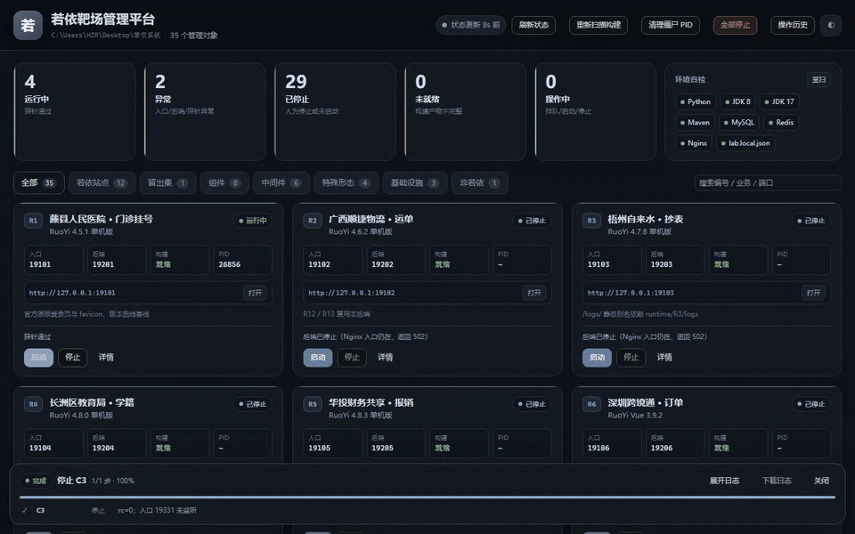
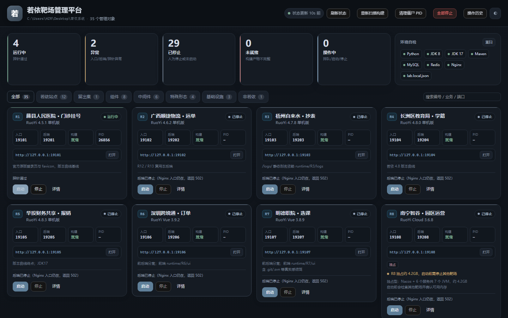
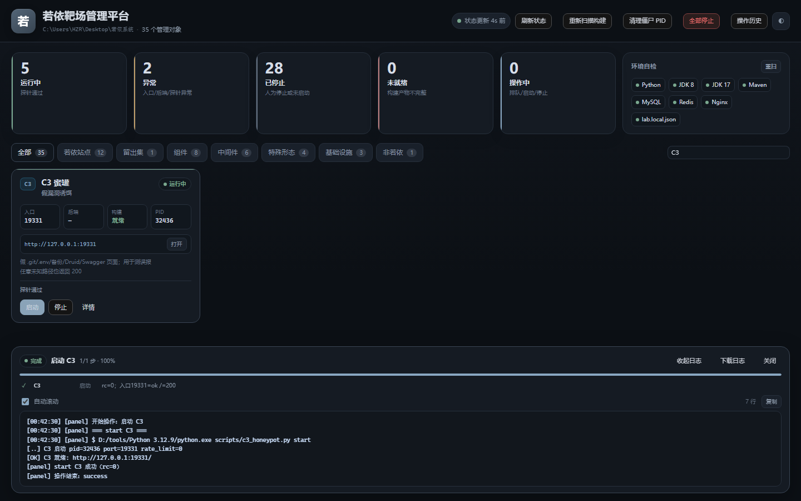
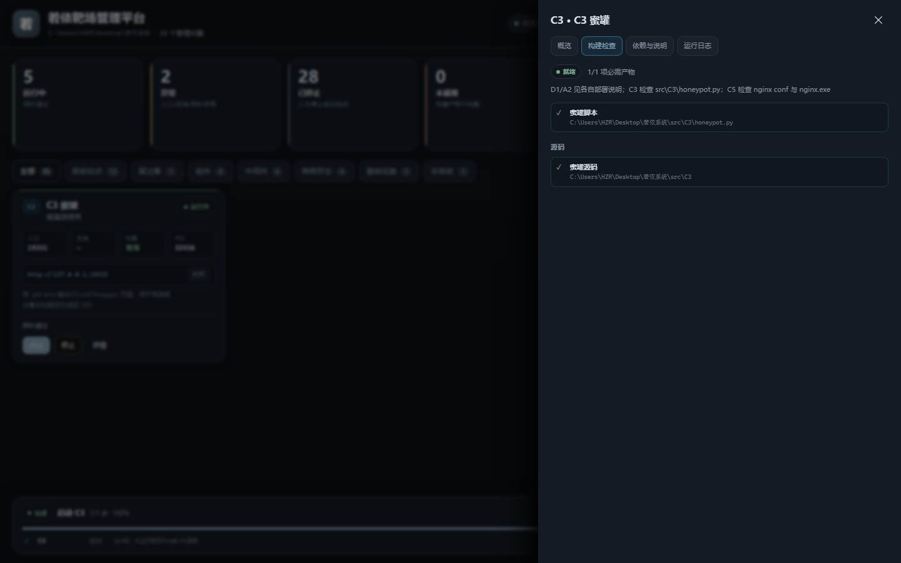
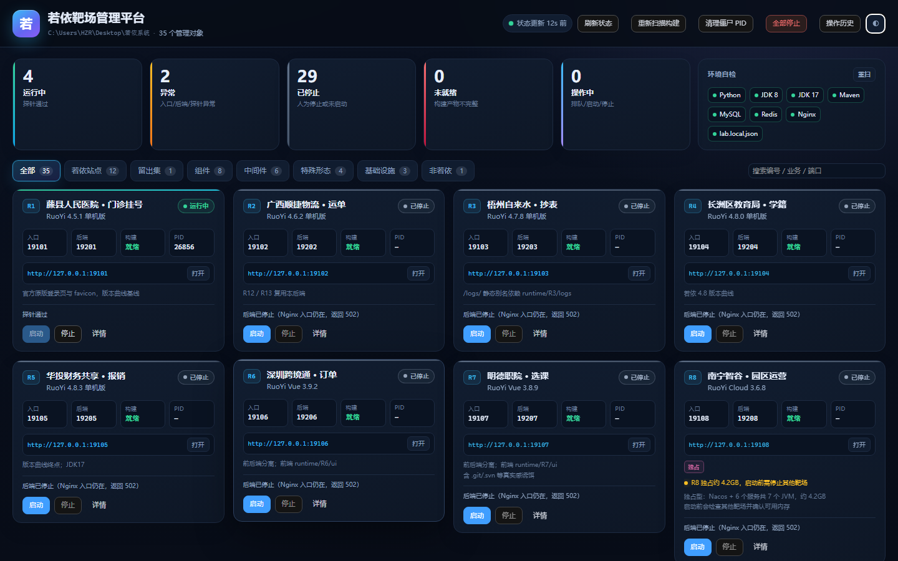

# 若依靶场 Web 管理平台

> 35 个目标，一页管完：构建就绪度、运行状态、一键启停、实时日志。

靶场多了以后，启动本身就是一场排障：端口记不住、jar 有没有构建不确定、Nginx 502 和真挂了分不清。
这个面板把 `lab.py` 的注册表、探针和启停脚本搬进一个本机网页，同时补齐了原脚本没有的
构建检查、共享 Nginx 状态、依赖处理和实时日志。



## 实际运行截图

| 总览（沉稳） | 运行时日志 |
|---|---|
|  |  |

| 构建检查 | 炫酷主题 |
|---|---|
|  |  |

> 截图为真实运行状态：R1 正在运行；R12/D1 的 nginx conf 启用但后端未起时，
> 面板会直接标成异常，而不是像 `netstat` 那样看起来“端口还在”。

## 启动

双击：

```
tools\panel\start-panel.bat
```

或从靶场根目录运行：

```bash
python -m tools.panel.run
```

浏览器打开 <http://127.0.0.1:19500>。默认只绑定回环地址。

批处理也支持指定端口和“不自动开浏览器”：

```bat
tools\panel\start-panel.bat 19501 --no-browser
```

依赖：Python 3.9+、`fastapi`、`uvicorn`。启动脚本会检查；缺少时安装：

```bash
python -m pip install -r tools\panel\requirements.txt
```

关闭面板窗口不会停止已经启动的靶场。

## 功能

- **构建扫描**：以 `build/`、`runtime/`、`nginx/conf.d/` 中真正启动用的产物为准，
  不看 `src/**/target`（C2 的 safe 构建会清掉 target 里的另一份 jar）。
  状态分 `就绪 / 部分就绪 / 未构建 / 缺失`，缺失项会列出具体路径和构建提示。
- **运行状态**：复用 `lab.py` 的入口 + 后端 + 业务探针，再叠加 PID、nginx conf 状态，
  区分 `运行中 / 异常 / 已停止 / 故障 / 未就绪`；解决共享 Nginx 时“后端已停但入口还在 502”
  被误显示为异常的问题。
- **单站启停**：启动/停止时在后台串行执行，页面实时输出命令日志。
- **分组批量**：按分组启动/停止；`site` 组启动会自动跳过 R8（独占）和 R13（hold-out）。
- **全部停止**：按依赖顺序停站点/组件/中间件，最后关 Nginx；**MySQL / Redis 保留运行**。
- **依赖处理**：启动 C5 自动带起 C2-1b；启动 Y1 自动带起 C4-1；R12/R13 由 `lab.py` 带起 R2。
- **R8 独占预检**：启动前并行检查其他靶场，弹窗确认后可先停冲突靶场再启动；并检查可用内存。
- **环境自检**：JDK8/JDK17/Maven/MySQL/Redis/Nginx/Python/`lab.local.json` 一目了然。
- **主题设置**：右上角 `◐` 打开设置，可切换 深色/浅色 与 沉稳/炫酷；默认沉稳，
  选择保存在 localStorage。炫酷主题保留原来的高对比霓虹风格。
- **僵尸 PID 清理**：入队执行 `lab.py clean`。
- **历史与日志**：最近 20 条操作、每操作 2000 行日志；支持运行日志尾部查看、复制、下载。

## 状态口径

构建层：

| 状态 | 含义 |
|---|---|
| `ready` | 必需 runtime 产物齐全 |
| `partial` | 主产物在，部分可选/前端产物缺失；允许尝试启动 |
| `unbuilt` | 源码在，runtime 产物缺失 |
| `absent` | 源码和运行产物都不在 |

运行层：

| 状态 | 含义 |
|---|---|
| `RUNNING` | 入口、后端、业务探针都通过 |
| `DEGRADED` | 入口在，但后端/探针异常 |
| `STOPPED` | 后端已停、PID 已退出，或 nginx conf 已禁用 |
| `BROKEN` | 进程还活着但端口不通，或配置启用但入口不通 |
| `NOT_READY` | 构建不完整且当前未运行 |

## 特殊目标

| 目标 | 处理方式 |
|---|---|
| **R8** | 独占约 4.2GB；启动前检查其他靶场和可用内存，不提供 `--force` |
| **R12** | 面板启用/禁用 `R12.conf`；停止不会停 R2 |
| **R13** | 走 `lab.py up/down`，由 `r13_start.py` 切换 conf |
| **C2-1a/1b** | 同生命周期；操作任一个都会启动/停止两者 |
| **C5** | 依赖 C2-1b（vuln 模式）；使用 `c5_start.py`，不用 `lab.py down C5` |
| **Y1** | 不在 `lab.py` 注册表；面板补了 C4-1 依赖、Y1.conf 切换和就绪等待 |
| **MySQL/Redis** | 面板不提供停止按钮；与 `lab.py` 的保守行为一致 |

## 设计

- `catalog.py`：35 个目标的展示元数据、构建检查、依赖计划、启停命令。
- `lab_bridge.py`：按路径加载 `scripts/lab.py` / `labenv.py`；运行状态、nginx conf、子进程执行。
- `status_poller.py`：后台线程池每 5 秒轮询，派生展示状态。
- `operations.py`：单工作线程串行队列，避免多个 `lab.py up` 抢 MySQL/Redis/Nginx。
- `app.py`：FastAPI 路由 + SSE；`run.py`：启动入口；`static/`：Vue 3 + Element Plus 单页。

面板不修改 `scripts/lab.py` 或任何靶场脚本；启停一律 shell out。

## 开发与测试

```bash
# 开发模式（改动自动重载）
python -m tools.panel.run --reload

# 单元测试（靶场根目录执行）
python -m unittest discover -s tools/panel/tests -t .
```

浏览器端静态资源已本地化到 `static/vendor/`（Vue 3.5.45 + Element Plus 2.14.8，MIT），
不依赖 CDN，离线可用。

## 安全

- 默认只绑定 `127.0.0.1`；靶场本身包含故意漏洞，不建议把面板暴露到局域网。
- 所有写接口要求 `X-Lab-Panel: 1` 请求头，不启用 CORS。
- 目标 ID 走白名单校验；子进程使用 argv 列表，不拼接 shell。
- 面板无登录：仅适合本机个人使用。

## 扩展

新增靶场时，在 `catalog.py` 的 `META` 与 `_build_checks` 中加一条；如果是
`lab.py` 已注册的目标，运行状态和启停会自动复用。当前**不做**未登记靶场的自动发现。
